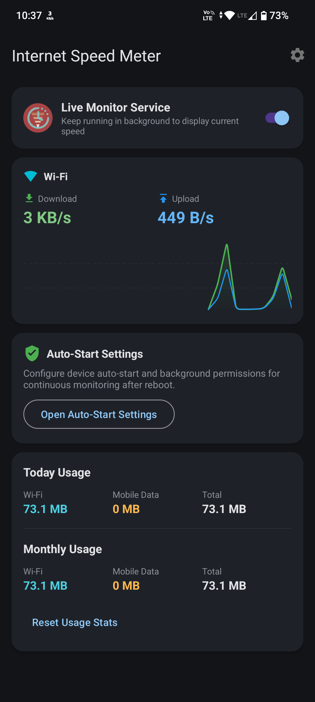
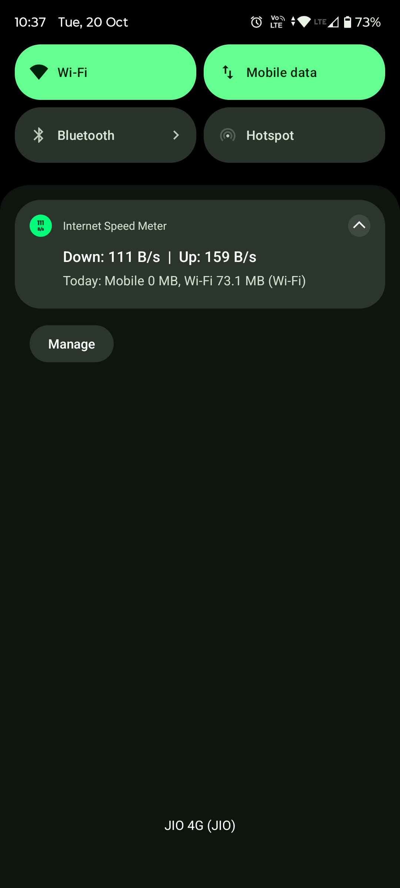

# Internet Speed Meter

Internet Speed Meter is a lightweight, background-focused Android application designed to track real-time internet upload and download speeds directly in the status bar and notification drawer. The application is built with a strong emphasis on minimal RAM footprint, zero unnecessary CPU wakeups, and high resilience against background service termination.

## Application Showcase

| Main Dashboard & Real-Time Graph | Status Bar Speed Display & Data Usage |
| :---: | :---: |
|  |  |

## Features

- Real-Time Speed Tracking: Live download and upload speed indicators updated directly on the status bar and notification panel.
- Dual Unit Support: Switch seamlessly between Bytes per second (KB/s, MB/s) and Bits per second (Kbps, Mbps).
- Low RAM Footprint: Operates with under 15 MB memory usage by avoiding heavy third-party frameworks and leveraging native Android TrafficStats APIs.
- Battery-Optimized Sampling: Automatic screen-off handling allows the app to pause or reduce sampling frequency when the screen is off, conserving battery life.
- Persistent Background Service: Operates as a Foreground Service with START_STICKY configuration and task-removal protection to prevent unexpected lifecycle termination.
- Auto-Start on Boot: Automatically resumes network speed monitoring when the device reboots or updates.
- Quick Settings Tile: Toggle the speed meter service on or off directly from the Android Quick Settings panel.
- Data Usage Breakdown: Separate daily and monthly data counters for Wi-Fi and Mobile Data networks.
- Real-Time Speed Graph: Canvas-based live line graph showing network speed fluctuations without external charting libraries.
- OEM Background Protection Guide: Includes built-in configuration guidance for device manufacturers like Xiaomi, Samsung, Huawei, Oppo, Vivo, Motorola, and OnePlus.

## Resource Efficiency (RAM and Battery Metrics)

- Memory Footprint: Less than 15 MB active RAM. Utilizes direct Android OS system APIs (`TrafficStats`) without bloated third-party libraries or background database workers.
- Battery Consumption: Less than 0.5% daily battery usage under active monitoring.
- Smart Power Saver Modes: Automatically slows sampling interval to 10 seconds or pauses sampling entirely when the device screen turns off, eliminating CPU wakeups during sleep.

## Background Operations and Battery Optimization Setup

To guarantee continuous 24/7 background speed monitoring without being closed or paused by system battery managers, configure the following settings:

### 1. Battery Optimization Exemption
- Open Android Settings > Apps > Internet Speed Meter > Battery (or App Battery Usage).
- Select Unrestricted (or Exempt from Battery Optimization).
- Alternatively, tap "Fix Protection" inside the app dashboard to launch the system optimization exemption dialog directly.

### 2. Disabling App Standby and Deep Sleep
- On Samsung (One UI): Open Settings > Battery > Background usage limits > Never sleeping apps > Add Internet Speed Meter.
- On Motorola (MyUX / Android 14): Open Settings > Apps > Internet Speed Meter > App battery usage > Set to Unrestricted.
- On Xiaomi / Redmi / POCO (MIUI / HyperOS): Open Settings > Apps > Permissions > Autostart -> Enable Autostart for Internet Speed Meter. In Battery Saver settings, set background profile to No Restrictions.
- On OnePlus / Oppo / Realme (OxygenOS / ColorOS): Open Settings > Battery > Advanced settings > Optimize battery use -> Set Internet Speed Meter to Don't optimize.
- On Vivo / IQOO (Funtouch OS): Open Settings > Battery > High background power consumption -> Enable for Internet Speed Meter.

### 3. Locking App in Recent Tasks
- Open the Recent Apps screen.
- Long-press or tap the app header icon for Internet Speed Meter.
- Select Lock to prevent system task cleaners from clearing the service process.

## Architecture and Design

- Technology Stack: Kotlin, Material Components 3, AndroidX Core, AndroidX AppCompat.
- Min SDK: Android 7.0 (API Level 24).
- Target SDK: Android 15 (API Level 35).
- Background Operations: Android Foreground Service (`SpeedMeterService`) with `FOREGROUND_SERVICE_IMMEDIATE` priority and `onTaskRemoved` auto-restart logic.
- Storage: Lightweight Android `SharedPreferences` for atomic usage counter persistence.
- Rendering: Custom View implementation (`SpeedGraphView`) utilizing native Android Canvas for line drawing.

## Setup and Permissions

The application requires the following permissions for full background functionality:

1. `FOREGROUND_SERVICE` and `FOREGROUND_SERVICE_SPECIAL_USE`: Required to maintain continuous speed monitoring in the background.
2. `POST_NOTIFICATIONS`: Required on Android 13 (API 33) and higher to display ongoing speed notifications.
3. `RECEIVE_BOOT_COMPLETED`: Required to start the service automatically after device restart.
4. `ACCESS_NETWORK_STATE`: Required to detect connection type (Wi-Fi vs Mobile Data).
5. `REQUEST_IGNORE_BATTERY_OPTIMIZATIONS`: Recommended to exempt the service from system battery saver restrictions.

## Building the Project

Ensure you have Android Studio installed along with JDK 17 or higher.

```bash
# Clone repository
git clone https://github.com/your-repo/InternetSpeedMeter.git

# Navigate into project directory
cd InternetSpeedMeter

# Build debug APK
./gradlew assembleDebug
```

## License

This project is open source and available under the Apache License 2.0.
